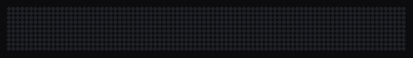
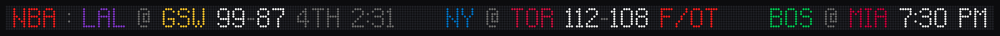
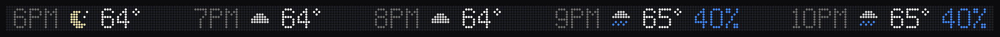
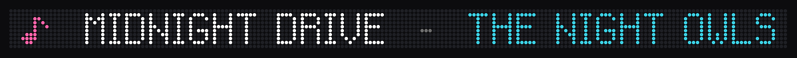
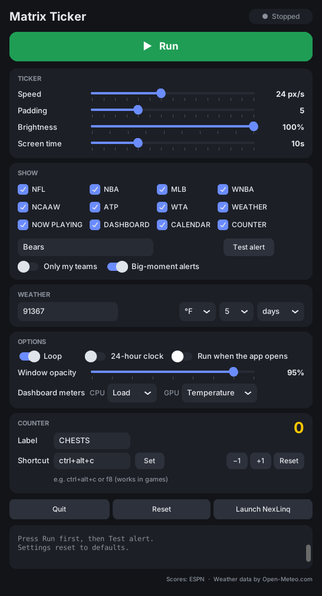

# Matrix Ticker

**Live scores, weather and more on the LED display of your Phanteks Evolv X2 Matrix case.**

## What it shows

**Live scores** in team colors: NFL, NBA, MLB, WNBA, women's college basketball (top 25) and tennis Grand Slams.
Only games happening today show up. Your **favorite teams** go first with a gold star, and
**big-moment alerts** flash on the display: kickoff, touchdowns, field goals, runs, close games late, wins.

**Weather** for your city: right now, sunrise and sunset, then the days or hours ahead (you pick how many).

**PC dashboard:** CPU and GPU meters (pick what they show: load, temperature, RAM, VRAM, power, fan), a big clock and the date.

**Calendar:** the day and date, with this week underneath.

**What's playing** from Spotify, YouTube and other apps.

**A counter** you bump with a key, even mid-game. Count chests, wins, anything.

## Install

1. Download **MatrixTicker-Setup.exe** from the [latest release](https://github.com/zaycation/matrix-ticker/releases/latest).
2. Open it. If Windows says **"Windows protected your PC"**, click **More info**, then **Run anyway**.
3. Click **Next** through the installer.

That's it. It can start with Windows and sits quietly by the clock.

## How to use it

1. Open **Matrix Ticker** from the Start menu.
2. Tick what you want to see.
3. For weather, type your city or ZIP code.
4. Press the big green **Run** button. Change something while it runs and a **Restart** button
   appears to apply it.

Everything you change is saved. **Window opacity** (under Options) makes the window see-through. Closing the window keeps it running in the
**system tray** (the little icons by the clock). Right-click that icon to stop it or quit.

**Favorite teams:** type them under Show, like `Bears, Sparks` (team names or abbreviations).
Turn on **Only my teams** to hide every other game. **Test alert** shows a sample on the display.

**Counter:** tick **COUNTER**, type a label (like `CHESTS`) and a key (like `f8`), then click **Set**.
Press that key anytime to add one; the display shows the new count for a few seconds.

**NexLinq:** Phanteks' own app can't run at the same time, so Matrix Ticker closes it when you
press Run (if it's open). You don't need it installed. Use **Launch NexLinq** to bring it back.

 

## Something not working?

| What you see | What to do |
|---|---|
| `Error: open failed` | The display isn't found. Check that it's plugged in and NexLinq is closed. |
| `Is NexLinq still running?` | Close NexLinq (check the tray by the clock), then **Run** again. |
| Weather `couldn't find ...` | Try your ZIP code, or add the country: `Springfield, US`. |
| Nothing shows up | No games today? Tick **WEATHER** or **DASHBOARD** too. |
| Counter key doesn't work in a game | Pick a key the game doesn't use, like `f8`. |
| "Already running" | It's in the tray by the clock (click the **^** arrow). |

## Uninstall

**Windows Settings → Apps → Installed apps → Matrix Ticker → Uninstall.**

---

MIT licensed. Scores from ESPN. Weather by [Open-Meteo.com](https://open-meteo.com). Not affiliated with Phanteks.
Developers: see [docs/DEVELOPMENT.md](docs/DEVELOPMENT.md) and [docs/PROTOCOL.md](docs/PROTOCOL.md).
