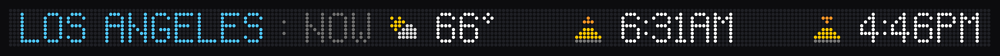
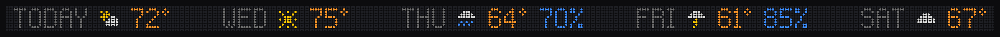
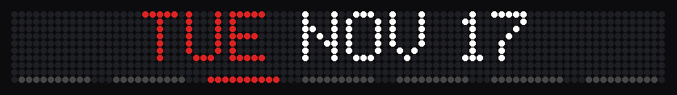
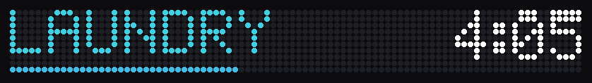

# Matrix Ticker

**Live scores, weather and more on the LED display of your Phanteks Evolv X2 Matrix case.**

## What it shows

**Live scores** in team colors: NFL, NBA, MLB, WNBA, women's college basketball (top 25) and tennis Grand Slams.
Only games happening today show up. Your **favorite teams** go first with a gold star, and
**big-moment alerts** flash on the display: kickoff, touchdowns, field goals, runs, close games late, wins.

**Weather** for your city: right now, sunrise and sunset, then the days or hours ahead (you pick how many).

**PC dashboard:** CPU and GPU meters (pick what they show: load, busiest core, temperature, RAM, VRAM, power, fan), a big clock with seconds, and the date (or ping) in the corner.

**Calendar:** the day and date, with this week underneath.

**What's playing** from Spotify, YouTube and other apps.

**A counter** you bump with a key, even mid-game. Count chests, wins, anything.

## Install

1. Download **MatrixTicker-Setup.exe** from the [latest release](https://github.com/zaycation/matrix-ticker/releases/latest).
2. Open it. If Windows says **"Windows protected your PC"**, click **More info**, then **Run anyway**.
3. Click **Next** through the installer.

That's it. It can start with Windows and sits quietly by the clock.

## How to use it

1. Open **Matrix Ticker** from the Start menu.
2. Tick what you want to see.
3. For weather, type your city or ZIP code.
4. Press the big green **Run** button. Change something while it runs and a **Restart** button
   appears to apply it.

Everything you change is saved. **Window opacity** (under Options) makes the window see-through. Closing the window keeps it running in the
**system tray** (the little icons by the clock). Right-click that icon to stop it or quit.

**Favorite teams:** type them under Show, like `Bears, Sparks` (team names or abbreviations).
Turn on **Only my teams** to hide every other game. **Test alert** shows a sample on the display.

**Ping:** the dashboard's top-right corner takes turns between the date and your ping (green, gold,
red, or **DOWN**). Change it under Options → Dashboard corner.

**Earthquakes:** magnitude 3.5+ within 50 miles of your weather location cut in right away
(**QUAKE M4.1**, then how far and which way). Change the distance or turn it off under Weather.

**Fantasy football (Sleeper):** tick **FANTASY** and type your Sleeper username. Your matchup
scrolls by (green when you're winning), and with alerts on, a starter's big play flashes up, like
`J. ALLEN +6.4`. Type part of a league name to show just that league.

**Game updates (patch notes):** tick **PATCHES** and list up to 3 games. With a game's official
notes page (WoW Forever comes filled in with Blizzard's hotfix list), new notes cut in with a quick
summary: the date, how many changes, and the first change in each of the top categories. With no
page, it watches the news for "<game> patch notes" headlines instead (handy until a page exists, like
GTA 6 today). Recent notes stay in the cycle for 2 days. `python tools/patchnotes_check.py` shows what
it finds right now.

**Messages from a phone:** tick **MESSAGES**. The app makes a private link (Messages section →
**Copy**). Anything sent to that link flashes the whole display pink and white, then scrolls by with a
heart and the sender's name,
then stays in the cycle until midnight (or **Clear**). Emoji are dropped (the LEDs can't draw them).
Anyone with the link can send, so only share it with people you want; **New link** replaces it.

Set it up on an iPhone with the Shortcuts app (2 minutes):
1. Shortcuts → **+** (new shortcut). Add the action **Ask for Input**: type *Text*, prompt
   *Message for the PC*.
2. Add **Get Contents of URL**. URL: paste the link. Tap the arrow to show more:
   **Method** *POST*; **Headers** → add *Title* = her name (shown on the display);
   **Request Body** *File* → choose the *Provided Input* from step 1.
3. Optional: add **Show Notification** with *Sent!*.
4. Rename it (e.g. *Message Zay's PC*), then **Share → Add to Home Screen**.
   Siri works too: "Hey Siri, Message Zay's PC".

No iPhone? Opening the link in any browser shows a page with a box to send from.

**Meetings:** tick **MEETINGS** and paste your calendar's private iCal link (Google Calendar:
Settings → your calendar → *Secret address in iCal format*). Meetings show up only when they start
within the next 90 minutes (you can change that), and a reminder flashes 5 minutes before.
All-day events, cancelled meetings and ones you declined are skipped.

**Open when Windows starts** (under Options): Matrix Ticker opens in the tray when you sign in.
Turn on **Start ticker when app opens** too, and the display starts on its own after every boot.

**Keep PC awake** (on by default): while the ticker runs, Windows won't go to sleep on its own,
though your monitors can still turn off. If you put the PC to sleep yourself, the display goes dark
with it and the ticker picks back up when the PC wakes.

**Updates:** the app checks for a new version once a day and shows a **Download** button when one is out.

**Timer:** tick **TIMER**, name it (`FOCUS`, `LAUNDRY`), pick the minutes and press **Start**, or use
the shortcut (`ctrl+alt+t`), which works in games. While it runs, the display shows the countdown;
at zero it flashes **TIME'S UP** and the ticker carries on.

**Counter:** tick **COUNTER**, type a label (like `CHESTS`) and a key (like `f8`), then click **Set**.
Press that key anytime to add one; the display shows the new count for a few seconds.

**NexLinq:** Phanteks' own app can't run at the same time, so Matrix Ticker closes it when you
press Run (if it's open). You don't need it installed. Use **Launch NexLinq** to bring it back.

 

## Something not working?

| What you see | What to do |
|---|---|
| `Error: open failed` | The display isn't found. Check that it's plugged in and NexLinq is closed. |
| `Is NexLinq still running?` | Close NexLinq (check the tray by the clock), then **Run** again. |
| Weather `couldn't find ...` | Try your ZIP code, or add the country: `Springfield, US`. |
| Nothing shows up | No games today? Tick **WEATHER** or **DASHBOARD** too. |
| Counter key doesn't work in a game | Pick a key the game doesn't use, like `f8`. |
| "Already running" | It's in the tray by the clock (click the **^** arrow). |

## Uninstall

**Windows Settings → Apps → Installed apps → Matrix Ticker → Uninstall.**

---

MIT licensed. Scores from ESPN. Fantasy from Sleeper. Earthquakes from the USGS. Weather by [Open-Meteo.com](https://open-meteo.com). Not affiliated with Phanteks.
Developers: see [docs/DEVELOPMENT.md](docs/DEVELOPMENT.md) and [docs/PROTOCOL.md](docs/PROTOCOL.md).
